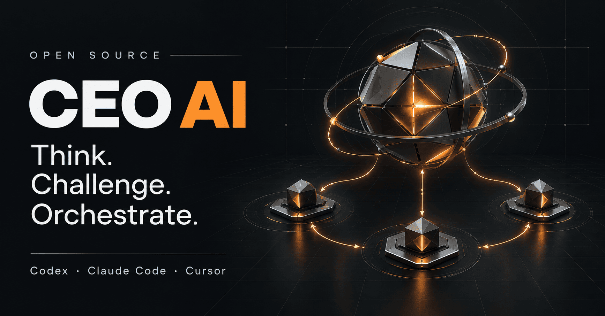

# CEO AI

<a href="https://bearatol.github.io/ceo-ai/ru/"></a>

[English](README.md) · [Русский](README.ru.md) · [简体中文](README.zh-CN.md)

**[Сайт](https://bearatol.github.io/ceo-ai/ru/) · [Примеры для разных профессий](https://bearatol.github.io/ceo-ai/ru/#cases) · [Установка](https://bearatol.github.io/ceo-ai/ru/#install) · [Помощь](https://bearatol.github.io/ceo-ai/ru/#help)**

На сайте есть примеры задач и сообщение для установки через вашего агента.

**Не знаешь, как лучше сделать? Посоветуйся с ИИ CEO.**

CEO AI добавляет в Codex, Claude Code или Cursor помощника, с которым можно
обсудить идею, выбрать решение и довести задачу до результата. Он задаёт вопросы
по существу, замечает слабые места в ваших предложениях и объясняет, что стоит
проверить перед началом работы.

CEO AI находится в активной разработке: мы тестируем навык-оркестратор и
дорабатываем его по результатам проверок и обратной связи.

Например, вы хотите переписать приложение. CEO сначала поможет разобраться,
какую проблему должно решить переписывание приложения, сравнит его с небольшими доработками и
предложит способ проверить выбор. Если решение принято, составит план и поможет
его выполнить.

## Начать пользоваться

Откройте свой проект в **Codex, Claude Code или Cursor** и отправьте агенту:

```text
Установи CEO AI для моего ИИ-приложения по инструкции.
Проверь прежнюю установку. Используй плагин, если приложение его поддерживает.
Сначала объясни область установки. Сохрани мой проект и локальные правки.
https://github.com/bearatol/ceo-ai/blob/v0.4.0/INSTALL.md
```

В Codex и Claude Code доступна установка через менеджер плагинов. Для Cursor
остаётся установщик в проект. Он также подходит для Codex и Claude Code на
Windows, macOS и Linux. Менеджеры плагинов хранят часть настроек вне проекта.
Создавать папки и копировать файлы вручную не нужно.

После установки начните новый чат. Для плагина выберите **`ceo-ai:ceo-ai`**
в Codex или вызовите **`/ceo-ai:ceo-ai`** в Claude Code. При установке в проект:
**`$ceo-ai`** в Codex, **`/ceo-ai`** в Claude Code и Cursor.

[Плагины: установка, обновление и переход](docs/PLUGINS.md#русский) ·
[Microsoft APM](docs/APM.md#русский)

## Что можно попросить

> Хочу запустить новый продукт. Помоги понять, что проверить до разработки.

> Думаю переписать сервис. Найди слабые места этого решения и предложи альтернативы.

> Нужно добавить оплату. Составь план, помоги реализовать его и проверить результат.

Начните с того, что хотите получить. Добавьте срок, бюджет или другие ограничения,
если они есть. Длинный бриф заранее готовить не требуется.

## Короткий пример

Это иллюстрация, а не запись реального запуска или результат сравнения моделей:

> **Вы:** Давай перепишем сервис с нуля. Он слишком медленный.
>
> **CEO:** Какая часть тормозит и что уже измерили? Переписывание может оказаться
> дорогим и при этом не устранить причину.
>
> **Вы:** Долго формируется отчёт. Остальное работает нормально.
>
> **CEO:** Начнём с одного отчёта: измерим время, найдём самый медленный шаг
> и проверим точечное изменение. По результату решим, нужно ли переписывать сервис.

Результат обсуждения: конкретный следующий шаг и способ оценить его пользу.
Если нужны изменения в коде, CEO затем поможет выполнить план и проверить результат.

## Совместимость и проверки

| Способ установки | Проверено | Пока не проверено |
| --- | --- | --- |
| Плагины Codex / Claude Code | Установка, обновление, удаление и обнаружение навыка на macOS | Ответ модели; менеджеры плагинов на Windows/Linux |
| Установщик в проект, все три приложения | Работа с файлами в CI на Windows, Linux и macOS | Вызов навыка внутри приложений |
| APM 0.31.0 | Работа с файлами на macOS с CEO AI 0.2.0 | Повторная проверка с 0.4.0 |

Плагины проверены в Codex CLI 0.147.0 и Claude Code 2.1.232. Приложения
обнаружили навык. Это ещё не подтверждает, что модель следует всем инструкциям.
[Результаты и ограничения](docs/PLUGINS.md#что-проверено) ·
[Автоматические проверки](https://github.com/bearatol/ceo-ai/actions/workflows/checks.yml).

## Как он помогает

- **Обсуждает решение.** Уточняет то, что влияет на выбор, объясняет возражения
  и меняет собственную рекомендацию, если появляются новые факты.
- **Организует выполнение.** Разбивает большую работу на понятные шаги.
  Если приложение позволяет запускать других ИИ-помощников, может поручить одному
  реализацию, а другому проверку результата.
- **Проверяет конкретные вещи.** Для кода это тесты и соответствие задаче.
  Для текста: понятность, противоречия и утверждения без подтверждений.
  Для плана: пропущенные шаги, зависимости и способы исправить неудачное решение.
- **Просит второе мнение.** Перед решением с высокой ценой ошибки запускает
  отдельного ИИ-помощника, чтобы тот поискал слабые места в предложенном подходе.
  Это отдельная проверка внутри приложения. Никому звонить или писать не нужно.

Простой вопрос не должен превращаться в совещание команды. Если запуск других
ИИ-помощников недоступен, CEO скажет об этом. Он не будет выдавать собственную
повторную проверку за независимое мнение.

## Помощь и новости проекта

Если установка остановилась или навык не появился, откройте
[помощь с установкой](docs/HELP.ru.md). Можно [сообщить о проблеме](https://github.com/bearatol/ceo-ai/issues/new/choose).
Есть [история изменений, на английском](CHANGELOG.md), [выпуски](https://github.com/bearatol/ceo-ai/releases),
[правила участия](CONTRIBUTING.md) и [приватный канал для уязвимостей](SECURITY.md).
Последние две инструкции также на английском.

## Обновление и удаление

Попросите агента обновить или удалить CEO AI тем же способом, которым он был
установлен, и передайте [инструкцию](INSTALL.md). Удаление пользовательского
плагина Codex затронет все проекты, где он используется. Удаление навыка из
проекта затронет и Cursor, если папка общая. Локальные правки нужно сохранить.

CEO AI использует вашу текущую модель и её обычные инструменты. Ответы ИИ требуют
проверки; второе мнение тоже может ошибаться. CEO не получает дополнительных прав
и не заменяет обязательную проверку безопасности вашего проекта.

[Устройство и проверка комплекта](docs/DEVELOPMENT.md) ·
[Как работает CEO](docs/CEO_GUIDE.md) · [MIT](LICENSE)

## Автор

[Telegram @bearatol](https://t.me/bearatol) · [LinkedIn](https://www.linkedin.com/in/mikhail-diesperov/)
