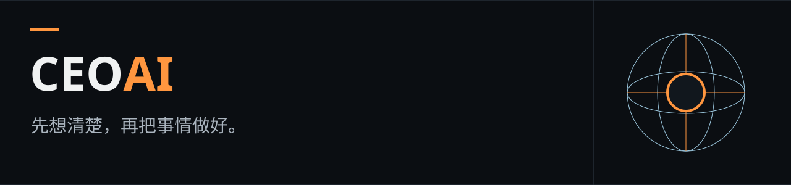

# CEO AI

[](https://bearatol.github.io/ceo-ai/zh/)

[English](README.md) · [Русский](README.ru.md) · [简体中文](README.zh-CN.md)

**[网站](https://bearatol.github.io/ceo-ai/zh/) · [各职业使用示例](https://bearatol.github.io/ceo-ai/zh/#cases) · [安装](https://bearatol.github.io/ceo-ai/zh/#install) · [帮助](https://bearatol.github.io/ceo-ai/zh/#help)**

网站提供使用场景和可直接发给智能体的安装消息。

**不知道怎样做更合适？先和 AI CEO 商量一下。**

CEO AI 为 Codex、Claude Code 和 Cursor 提供一套工作方法，帮助你讨论想法、选择方案，
再把任务做完。它会提出影响结果的问题，指出依据不足的假设，并说明开始前需要验证什么。

CEO AI 正在积极开发中。我们持续测试这个协调任务的技能，并根据测试结果和反馈改进它。

比如，你想重写一个应用。CEO 会先帮你明确重写要解决的问题，与小范围修改作比较，
再建议如何验证这个选择。决定之后，它会帮你制定计划并推进工作。

## 开始使用

适用于 Windows、macOS 和 Linux。智能体会选择适合当前系统的安装方式。
在 **Codex、Claude Code 或 Cursor** 中打开你的项目，然后向智能体发送：

```text
请按照以下说明，把 CEO AI 安装到当前项目。
请先识别我的操作系统，并检查所需工具。
https://github.com/bearatol/ceo-ai/blob/v0.3.0/INSTALL.md
```

智能体会阅读说明，为当前工具安装技能并检查文件。如果应用需要授权，它会提示所需权限。
你不需要手动创建文件夹、复制技能或填写仓库路径。安装仅作用于这个项目。

安装后，在该项目中开启新会话。Codex 使用 **`$ceo-ai`**，
Claude Code 和 Cursor 使用 **`/ceo-ai`**，然后用自己的话描述任务。

已经在用 Microsoft APM？也可以按 [APM 说明](docs/APM.md#简体中文)安装。

## 可以这样问

> 我想推出一个新产品。帮我判断开发之前应该先验证什么。

> 我打算重写这个服务。请找出这个决定的薄弱之处，并提出其他方案。

> 我们需要增加支付功能。请制定计划，协助实现，并检查结果。

先说明你想得到什么结果。如果有期限、预算或其他限制，也一起告诉它。
不必提前准备一份很长的需求文档。

## 简短示例

以下是说明用的对话，不是实际运行记录，也不是模型评测结果：

> **你：** 服务太慢了，我们从头重写吧。
>
> **CEO：** 具体是哪一部分慢？已经测量过什么？重写可能成本很高，却没有解决原因。
>
> **你：** 生成报表很慢，其他部分都正常。
>
> **CEO：** 先选一份报表，测量耗时，找出最慢的步骤，再验证一个有针对性的修改。
> 根据结果判断是否需要重写整个服务。

讨论的结果是一个明确的下一步，以及判断它是否有效的方法。
如果需要修改代码，CEO 可以继续协助执行计划并检查结果。

## 兼容性与验证情况

| 工具 | 文件安装、更新和卸载 | 在应用中调用技能 |
| --- | --- | --- |
| Codex | 已在 Windows、Linux 和 macOS CI 中验证 | 尚未验证 |
| Claude Code | 已在 Windows、Linux 和 macOS CI 中验证 | 尚未验证 |
| Cursor | 已在 Windows、Linux 和 macOS CI 中验证 | 尚未验证 |

默认安装器已在 Windows、Linux 和 macOS CI 中验证。APM 0.31.0 仅在 macOS 上与 CEO AI 0.2.0 一起验证，尚未针对 0.3.0 重新测试。
技能的实际行为及其他 AI 助手的可用性取决于应用、版本和设置。Windows 安装支持普通本地项目文件夹，包括含空格和中文的路径。
参见[验证说明（英文）](docs/DEVELOPMENT.md)和
[自动检查](https://github.com/bearatol/ceo-ai/actions/workflows/checks.yml)。

## 它如何协助你

- **讨论选择。** 询问可能改变决策的信息，解释反对理由，并在新证据出现时修正自己的建议。
- **安排工作。** 把大任务拆成清楚的步骤。如果应用支持其他 AI 助手，可以让一个负责实现，另一个检查结果。
- **检查具体问题。** 对代码，运行测试并核对需求；对文字，检查是否清楚、有无矛盾或缺乏依据的说法；
  对计划，检查遗漏步骤、依赖关系，以及选错方案后如何补救。
- **征求第二意见。** 在作出失败代价较高的决定前，请另一个 AI 助手寻找方案中的薄弱之处。
  审查在应用内进行，不会联系任何真人。

简单问题不应变成一次团队会议。如果无法启动其他 AI 助手，CEO 应明确说明，
不能把自己再检查一遍说成独立审查。

## 帮助与项目更新

如果安装停止或找不到技能，请先查看[安装帮助](docs/HELP.zh-CN.md)。
也可以[报告问题](https://github.com/bearatol/ceo-ai/issues/new/choose)。
更多信息：[更新与迁移记录（英文）](CHANGELOG.md)、[发布版本](https://github.com/bearatol/ceo-ai/releases)、
[贡献指南（英文）](CONTRIBUTING.md)和[私密漏洞报告（英文说明）](SECURITY.md)。

## 更新或卸载

告诉智能体“更新当前项目中的 CEO AI”或“从当前项目卸载 CEO AI”，
并提供[这份说明](INSTALL.md)。如果安装后的文件被修改过，智能体应先保留改动并处理冲突。

CEO AI 使用你现有的模型和工具。AI 的回答需要核实，第二意见也可能出错。
CEO 不会获得额外权限，也不能替代项目要求的安全审查。

[开发与验证](docs/DEVELOPMENT.md) · [CEO 工作流程](docs/CEO_GUIDE.md) · [MIT 许可证](LICENSE)

## 作者

[Telegram @bearatol](https://t.me/bearatol) · [LinkedIn](https://www.linkedin.com/in/mikhail-diesperov/)
